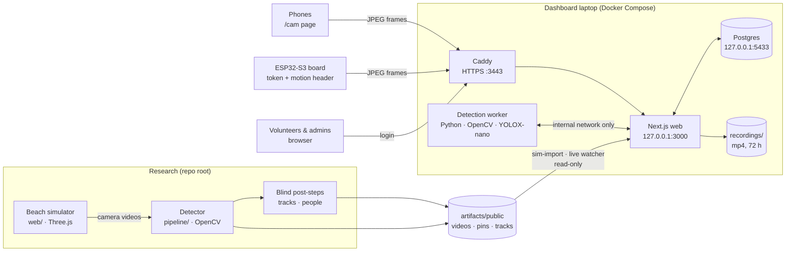
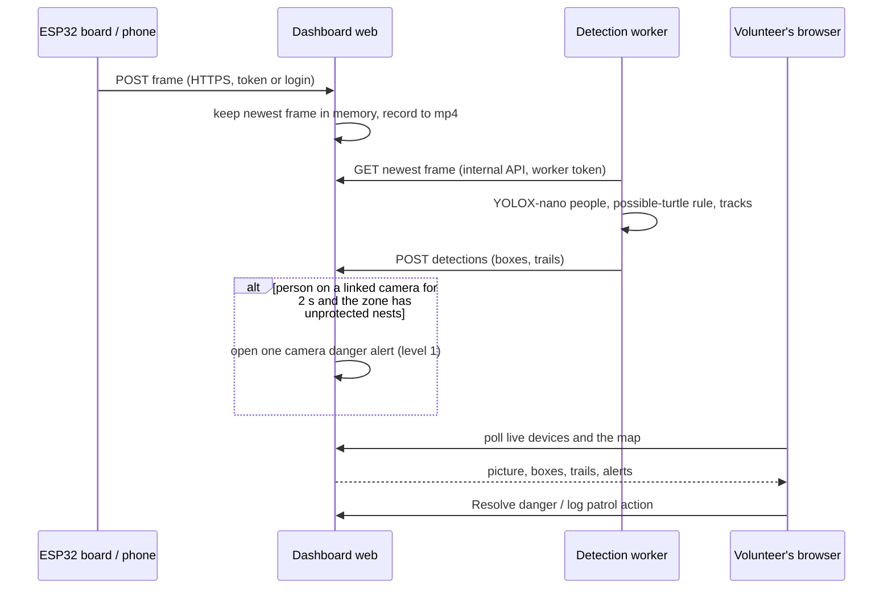
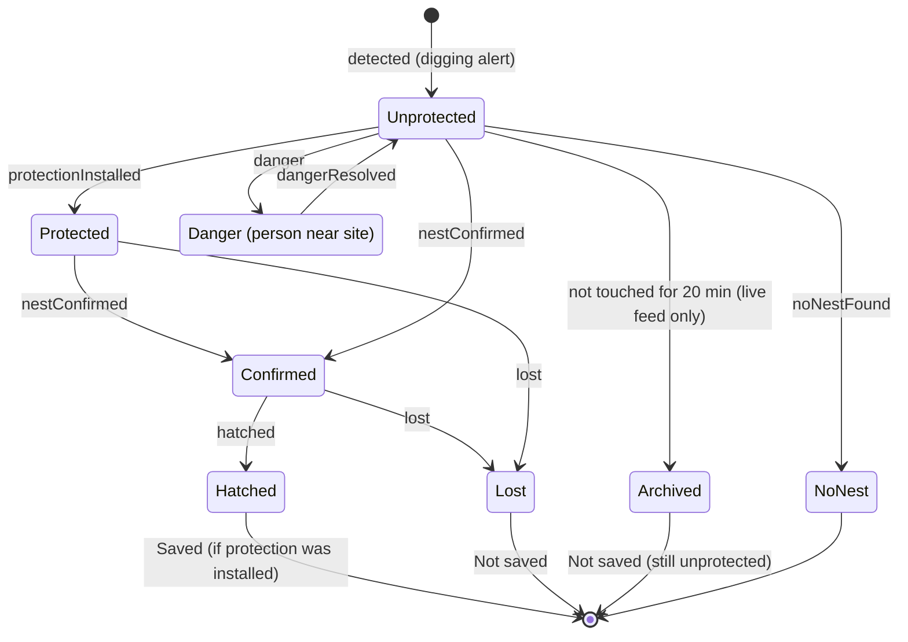
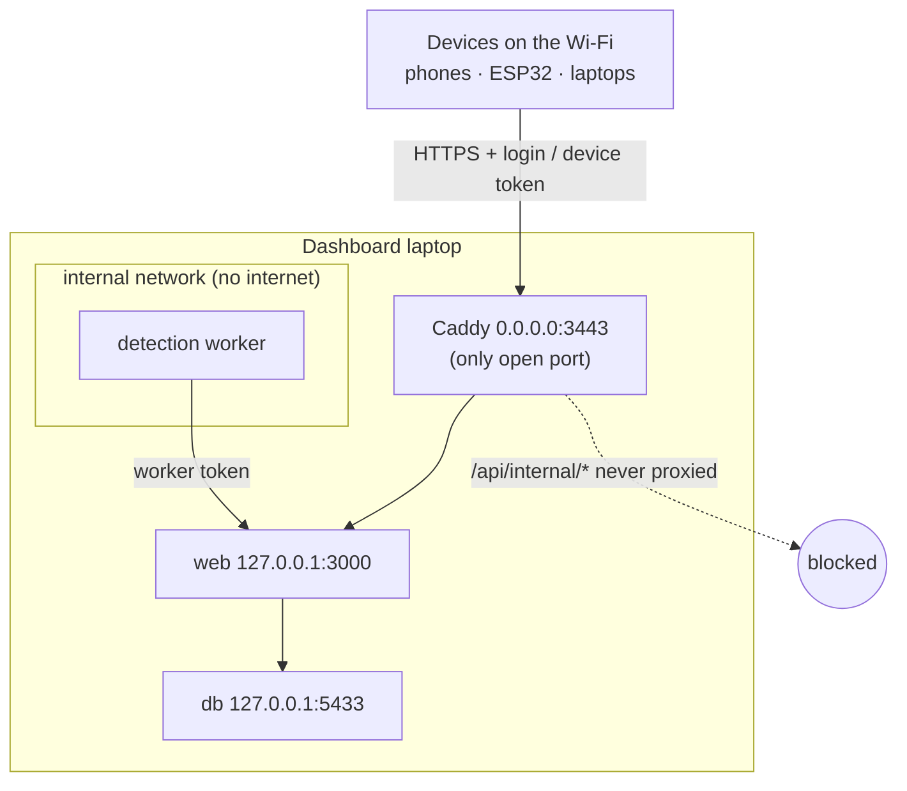

# NestTrace

NestTrace helps sea turtle patrol volunteers find and protect nests sooner. Cameras on the beach (phones or a small ESP32 camera board) stream to a dashboard on one laptop. The dashboard shows where turtles were seen digging, keeps a shared log of every nest site, detects people and possible turtles on the live cameras, and raises a danger alert when a person is on camera near unprotected nests. **Only a volunteer can confirm a nest; the software never does.**

The repository holds three parts that never import each other:

| Part | Folder | What it is |
| --- | --- | --- |
| Research simulator and detector | `web/`, `pipeline/`, `scripts/`, `config/` | A 3D particle-sand beach that renders camera videos of turtles digging, plus the OpenCV detector measured on them. |
| Dashboard | [`dashboard/`](dashboard/README.md) | Docker Compose app: Next.js + Postgres, Caddy HTTPS for phones, a Python detection worker. |
| Camera board firmware | [`firmware/esp32s3-cam/`](firmware/esp32s3-cam/README.md) | ESP32-S3 camera that streams to the dashboard over verified HTTPS and measures motion on the chip. |

They exchange data only through small versioned contracts in [`schemas/`](schemas/). [`agent.md`](agent.md) is the boundary document.

## How it fits together



### A live frame, from camera to alert



### Life of a nest site

A digging alert becomes a nest site with an append-only log, and its state is always derived from that log. Only a volunteer moves it past "Unprotected". Analytics counts a site as **Saved** when it hatched after protection was installed, and **Not saved** when it was lost, archived while unprotected, or had a danger event not followed by protection within 30 minutes.



### Who can reach what



## Quick start (dashboard)

```sh
cd dashboard
cp .env.example .env          # set secrets, LAN_HOST = this laptop's Wi-Fi address, WORKER_TOKEN
docker compose up -d --build  # web, db, caddy, worker
```

Open http://localhost:3000 on the laptop, or `https://<LAN_HOST>:3443` from a phone on the same Wi-Fi. Sign in with the seeded admin from `.env`. From **Live cameras**, use **Connect phone** (QR code) or **Add board camera** (ESP32). The full guide is [`dashboard/README.md`](dashboard/README.md).

## Research simulator

A local synthetic experiment for locating observable digging activity from saved beach videos. **It cannot confirm buried eggs.** TypeScript/Vite/Three.js generate two synchronized 1280 × 720 camera recordings; Python/OpenCV extracts differences and runs a separate blind detector. The 84 × 32 m beach is a two-layer bed of **134,400 physical grains**. Local forces wake grains; gravity, contacts, and friction govern their motion at 32 steps/s. The `swarm` and `swarm-night` scenarios send six turtles to separate sites at staggered times.

The dashboard imports reviewed simulation outputs through a separate adapter and never reads simulator state or private truth. This research simulator and its local API do not own real camera data or production operations.

## Run locally

Requires Node 22+, Python 3.10+, and Chrome/Edge (or Playwright Chromium). The checked-in lockfiles pin dependencies.

```powershell
npm install
python -m venv .venv
.\.venv\Scripts\python.exe -m pip install -r requirements.txt
npm run dev
```

In a second terminal:

```powershell
npm start
```

Open **http://127.0.0.1:5173**. Choose **Six turtles · large-beach stress** or **Six turtles · very dark and noisy**, use **Load simulation** to preview, then **Record & analyze** to generate actual videos and predictions. A saved run plays both Pure motion clips, offers synchronized source-camera playback, lets you inspect either camera's predictions and heatmap, and overlays calibrated motion on the beach map. For `swarm` and `swarm-night` runs it also groups calibrated **digging activity pins** and marks each on the map: green pins have detections from both cameras, amber pins have one view and need review. A pin is an inspection region, never a confirmed nest. The API binds to loopback only. Keep both terminals running. On the development machine a six-turtle two-camera recording took about 100 seconds with hardware rendering; extraction and detection took longer. Timing varies with graphics hardware and CPU.

To inspect the bundled development recording immediately, run `python scripts/install-example.py` before opening the UI. The example includes both saved camera videos, Pure motion videos, projected motion maps, extracted signals, predictions, calibration, and separate evaluator truth. The detector still receives only staged signal inputs.

`NESTTRACE_BROWSER` can specify a Chrome-compatible executable. On systems without Chrome/Edge, run `npx playwright install chromium`; the recording CLI then uses Playwright's browser. FFmpeg is provided by `imageio-ffmpeg`.

## Seaward layout, walkers, trails and people (opt-in)

`scripts/record.mjs` and `scripts/live-runner.mjs` accept two optional simulator settings. Defaults (`--layout along`, `--humans 0`) render byte-identical frames to before.

```sh
node scripts/record.mjs --seed 929 --scenario swarm --model A --layout seaward --humans 2 --id A-seaward-humans-demo-929
node scripts/live-runner.mjs --layout seaward --humans 2 --chunks 1
```

* `--layout seaward`: both cameras stand on the dune line, face the ocean and cross their views, so the surf is ahead. Marker visibility still bounds how far the views can turn.
* `--humans 0-4`: that many walkers cross the beach, some along the dug sites.
* Two blind scripts run after the digging pipeline and read only a run's public folder (`camera-N.mp4`, `calibration-N.json`, `timestamps.json`, and for trails `pins/`, `view-N/signals.npz`): `scripts/track_paths.py <run>` writes `tracks/tracks.json` (`schemas/tracks.v1.json`, points `[t, x, y]` in metres, each linked to a pin where one fits) and `scripts/people_detect.py <run>` writes `people/people.json` (`schemas/people.v1.json`). `people_detect.py` does not import `pipeline/detect.py`.

Limits: the layout and humans are **not registered experiments** and no result is claimed for them. Trails and people are blind and approximate. People detection is a calibrated height rule on moving blobs (OpenCV 5 ships no person detector), and very dark video is unsupported for people. People within 2 m of each other may merge into one track, and one person may still split into several tracks. Live chunks imported before this change have no trails or dangers.

## Reproduce the current paired stress experiment

The current six-turtle simulator compares paired daylight and very-dark synthetic videos on five registered seeds. The registration and fixed settings are in `config/swarm-registration.json` and `config/settings-swarm.json`. Run the batch with Vite serving port 5173:

```powershell
.\.venv\Scripts\python.exe scripts/swarm_batch.py
node scripts/swarm-check.mjs
```

The three-turtle result in `STRESS_RESULTS.md` belongs to revision `5ff15ae`, and the original one-turtle result in `RESULTS.md` belongs to `f50d04c`. Neither validates the current six-turtle beach. Current paired results are in `SWARM_RESULTS.md`.

## Reproduce the two-camera pin validation

Pins group calibrated predictions from both cameras into one inspection region per site. The rules and the fresh ten-seed registration are in [`config/pin-settings.json`](config/pin-settings.json) and [`config/pin-registration.json`](config/pin-registration.json); the measured result is in [`PIN_RESULTS.md`](PIN_RESULTS.md) and [`results/pin-v4.json`](results/pin-v4.json). Run the registered batch with both servers up:

```powershell
.\.venv\Scripts\python.exe scripts/pin_batch.py
node scripts/pin-browser-check.mjs
```

Across ten untouched daylight seeds the grouped pins matched **59/60** sites with **1** extra pin and a 0.58 m mean center error. The single miss was a 0.93 m center error against the registered 0.90 m radius; the target of 60/60 with zero extras therefore failed. Pins mark digging activity, not eggs: a negative audit shows travel and rest produce no pins, but unrelated sand movement, weak-motion misses, and dig-without-eggs cases remain. The very-dark condition still places no pins.

An optional exploratory low-light preprocessing probe uses the separate development recording, not the registered stress seeds. After recording `A-swarm-night-dev-601`, run `python scripts/lowlight_probe.py --run A-swarm-night-dev-601 --view 1`. It compares brightness gain, spatial blur, local contrast, and a three-frame temporal median while leaving the main extractor and detector settings untouched. See `SWARM_RESULTS.md` for the measured tradeoff; this probe is not a nighttime accuracy claim.

## Reproduce the original one-turtle experiment

Check out revision `f50d04c` in a separate worktree to reproduce its frozen validation; its freeze hashes intentionally reject the current simulator. Keep the Vite server running. On macOS/Linux replace `.\.venv\Scripts\python.exe` with `.venv/bin/python`.

```powershell
node scripts/record.mjs --seed 11 --scenario clean --model A
.\.venv\Scripts\python.exe scripts/analyze.py A-clean-11
.\.venv\Scripts\python.exe scripts/batch.py --split development --reuse
# Only before the first validation, if no freeze file exists:
.\.venv\Scripts\python.exe scripts/freeze.py
.\.venv\Scripts\python.exe scripts/batch.py --split validation --reuse
```

The committed registration specifies three development seeds, ten reserved Gate A seeds, twenty final test seeds, a 0.90 m prediction radius (2.545 m²), a 3.016 m² maximum region area (four nominal ellipse footprints), ≤0.90 m center error, ≥1 second temporal overlap, and one-to-one matching. Gate A requires at least 8/10 sites with at most 0.2 false alerts/run. This is a **nominal**, not each randomized turtle's individual, footprint budget. All methods use the same budget. Total inspection area is reported separately.

Settings and source hashes are frozen before reserved validation. Never tune using reserved validation or test results. Substantial revisions require registering fresh validation seeds and preserving the previous result. The same author implemented simulation, challenges, and detector; challenge design is **not independent**.

After Gate A, supported follow-up commands are:

```powershell
.\.venv\Scripts\python.exe scripts/batch.py --split demonstrations
.\.venv\Scripts\python.exe scripts/batch.py --split validation --model B
.\.venv\Scripts\python.exe scripts/analyze.py A-clean-11 --both
```

## Data boundaries

```text
artifacts/
  public/<run>/
    camera-0.mp4, camera-1.mp4       actual synchronized saved videos
    calibration-0.json, ...         visible marker correspondences
    timestamps.json                fixed frame times
    view-0/
      signals.npz                  background/motion/timestamps/valid only
      extraction.mp4               neutral blend | frozen | delayed
      pure-motion.mp4              native-resolution motion on black
      motion-map.png               transparent calibrated ground overlay
      metadata.json                timings and preprocessing diagnostics
      detection/
        predictions.json           all four methods
        input-manifest.json        exact allowed input hashes
        *-heatmap.png
  private/<run>/
    truth.json                     sites and eggs are separate
    config.json                    seed/scenario/sand model
    provenance.json                renderer, encoder, versions, hashes
    source-hashes.json
    evaluation-0.json
  reports/
  qa/
```

The extractor alone sees RGB. Detection executes in a fresh process and temporary working directory with only the detector source, helper module, signals, public calibration, and settings. It never reads simulator coordinates, identities, seeds, sand state, eggs, truth, overhead images, or RGB frames. This is an auditable input contract, **not an OS sandbox against hostile detector code**. The API serves only public artifacts; private truth requires an explicit reveal endpoint after completed inference. The simulator preview is for the operator, not an inference input.

## Methods

* Frozen reference: connected surface departure, spatially smoothed and peak localized.
* Delayed motion: accumulated recent differences, distinct from persistent differences.
* Blob tracker: nearest-centroid motion tracks and local dwell.
* Combined evidence: recent activity, dwell windows, persistent surface change, and travel continuity.

Calibration maps the central 24 × 16 m observed section of the 84 × 32 m beach into a 160×120 analysis grid. The two cameras face along the beach from opposite ends, 5.6 m above the sand with approximately four degrees of downward pitch, giving side views of inland-moving turtles. Each public calibration records mount position, orientation, field of view, visible ground markers, and map bounds. Reference marker neighborhoods supply stable features for affine registration and robust brightness gain/offset. The map can show either or both cameras' projected motion. Moving turtle parts are above the sand, so their flattened positions have parallax error. The calibration fit residual does not measure independent accuracy, camera survey error, or this parallax. Inspection radii are fixed by registration; scores are **not probabilities**.

The two sand generators differ structurally: A throws grains radially from rear-flipper strikes; B rakes alternating tangential strips. The grains receive velocity impulses, fly under gravity, collide, and settle. The model is coarse and bounded rather than real grain-scale sand. All visible effects are independent of hidden egg deposition. Unit/browser checks include identical rendered frames with only the hidden egg flag changed.

## Verify

```powershell
npm test
npm run build
node scripts/browser-check.mjs
node scripts/pin-browser-check.mjs
```

Browser checks require the servers and a completed `A-clean-11` run. When the paired development recordings are present, they also exercise their Pure motion playback, larger map, and Camera 02 evaluation. The pin check exercises the mapped pins, evidence tiers, and the reveal-only pin evaluation on `A-swarm-dev-601`. Checks cover preview controls, method switching, truth reveal, mobile overflow, and hidden-egg render invariance. Tests check temporal/spatial matching, duplicate predictions, oversized-region rejection, stationary change versus new motion, and the native-resolution Pure motion export.

## Limits

Read `SWARM_RESULTS.md` for the current paired stress measurements, `PIN_RESULTS.md` for the two-camera pin validation, and the earlier reports for historical versions. The very-dark mode uses reduced visible illumination and deterministic camera noise. It is **not an infrared model**, and synthetic performance does not establish nighttime field capability. Moving shadows and real camera motion are unvalidated. No energy savings are claimed. Videos are near-lossless H.264 sources, not byte-identical cross-driver reference images. The simulator uses bounded surface deformation, not grain-scale sand. Do not label an alert a confirmed nest.
